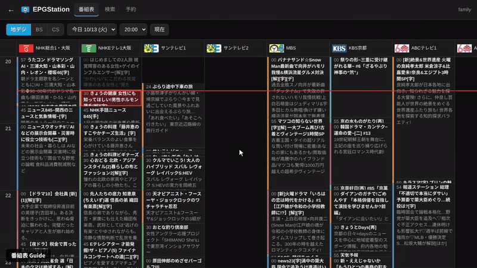

# EPGStation for Jellyfin

A Jellyfin plugin to schedule and unschedule [EPGStation](https://github.com/l3tnun/EPGStation)
recordings from Jellyfin. Browse the guide, search programmes, record, cancel.
No playback: recordings stay in EPGStation (add its recording folder to a Jellyfin library if you
want to watch them in Jellyfin).

[日本語](#日本語)



Full video (1:43): [demo.mp4](https://cdn.jsdelivr.net/gh/MyFeetHurt/jellyfin-plugin-epgstation@main/docs/demo.mp4) · Screenshots: [guide](docs/guide.png) / [programme](docs/detail.png) / [reservations](docs/reserves.png) / [phone](docs/phone.png) / [settings](docs/settings.png)

## Features

- **Guide** for 地デジ / BS / CS with channel logos and genre colours; scheduled, conflicting and
  skipped programmes are marked. Pick the day (8 days) and the start hour.
- **Search** by keyword in titles (optionally descriptions too), per broadcast type.
- **Record** a programme, **cancel** a reservation, **stop** a recording in progress (the part
  recorded so far is kept), **un-skip** an airing an EPGStation rule skipped.
- **Reservation list**: scheduled, conflicts, skipped, and which Jellyfin user scheduled each one.
- **All Jellyfin users** can use it, or only the users an administrator picks.
- English and Japanese (follows the browser language), works on phones.
- Builds for **Jellyfin 10.11** and **Jellyfin 12.x**.

## Install

1. Jellyfin → Dashboard → Plugins → Repositories → **+**, add
   `https://raw.githubusercontent.com/MyFeetHurt/jellyfin-plugin-epgstation/main/manifest.json`
2. Catalog → **EPGStation** → Install, then restart Jellyfin.
   Jellyfin picks the build for its version.
3. Dashboard → **EPGStation** (in the Plugins menu): enter the EPGStation URL as seen from the
   Jellyfin server, e.g. `http://192.168.0.10:8888`, and press *Save and test connection*.

Manual install: unzip a release zip into a new folder in Jellyfin's `plugins` directory
(`epgstation_X.Y.Z.11.zip` for 10.11, `epgstation_X.Y.Z.12.zip` for 12.x) and restart Jellyfin.
The folder must be writable by the user Jellyfin runs as (e.g. `chown -R jellyfin:jellyfin`):
Jellyfin 12 does not start when it cannot write the plugin's `meta.json`.

## Use

Open **`http://<jellyfin>/EpgStation/Web/`** in a browser where you are signed in to Jellyfin.
The settings page shows the link and an *Open the guide* button.

Jellyfin only shows plugin pages to administrators, so other users need the link: share it or
bookmark it (on a phone: *Add to Home screen*). The page uses the Jellyfin sign-in of that browser;
if you are not signed in, it links to the Jellyfin sign-in page. It doesn't appear in the Jellyfin
TV/phone apps.

Click a programme in the guide or a search result for details and the **Record** /
**Cancel recording** buttons.

## Settings

| Setting | |
|---|---|
| EPGStation URL | Address of EPGStation (the same as its web UI). Only the Jellyfin server talks to EPGStation; browsers don't need to reach it. |
| Basic auth | Only if EPGStation sits behind a reverse proxy with HTTP basic authentication. |
| All signed-in users / users | Who may use the page. Administrators always can. Allowed users see all reservations and may cancel any of them: EPGStation has no users of its own. |
| Encode after recording | An encode mode from EPGStation's `config.yml`, added to reservations made from Jellyfin. |

## How it works

The plugin adds a small REST API to Jellyfin under `/EpgStation/` that forwards a fixed set of
calls to EPGStation's API (channels, guide, search, reservations), after checking the Jellyfin user
is allowed. The page `/EpgStation/Web/` is plain HTML/JS embedded in the plugin.

What EPGStation does on a cancel:
- a one-off reservation is deleted;
- a rule's reservation is *skipped* (the rule stays; *Record again* un-skips it);
- a reservation that is recording now stops the recording and keeps the file.

Which Jellyfin user scheduled what is kept in `reservations.json` in the plugin's data folder.

## Build

.NET SDK 10 (it also builds the net9.0 target for Jellyfin 10.11):

```
dotnet build Jellyfin.Plugin.EpgStation -c Release
python3 tools/package.py --base-url https://example.invalid --out dist   # zips + manifest.json
```

Version numbers: `<PluginVersion>` in the csproj plus a 4th field for the Jellyfin line
(`.11` = 10.11, `.12` = 12.x). Jellyfin 12 would also accept 10.11 builds, so the 12 build must
have the higher number.

Releases: put a `## X.Y.Z` entry on top of `CHANGELOG.md`, set `<PluginVersion>`, commit, and push
the tag `vX.Y.Z`. The *Release* workflow builds both zips, creates the GitHub release and adds
them to `manifest.json` on `main`.

`tools/dev/` has the scripts used for development and testing (dev VM, dev EPGStation, API and
browser tests); they are specific to the author's network. `tools/demo/` records the demo video
(`prepare.py`, `record_demo.py`, `build_video.py`: headless Chromium + ffmpeg).

## License

GPL-3.0. Not affiliated with Jellyfin or EPGStation.

---

## 日本語

Jellyfin から [EPGStation](https://github.com/l3tnun/EPGStation) の録画予約・予約取り消しを行うプラグインです。
番組表・番組検索・録画予約・予約取り消し・録画停止ができます（[デモ動画](https://cdn.jsdelivr.net/gh/MyFeetHurt/jellyfin-plugin-epgstation@main/docs/demo.mp4)）。再生機能はありません
（録画ファイルを Jellyfin で見るには、EPGStation の録画フォルダーをライブラリに追加してください）。

- **番組表**（地デジ / BS / CS）: 局ロゴ、ジャンル色。予約済み・競合・除外を表示。
- **検索**: 番組名（概要も可）をキーワードで検索。
- **録画予約 / 予約を取り消す / 録画を停止 / 除外を解除**。
- **予約一覧**: 予約・競合・除外、どの Jellyfin ユーザーが予約したかを表示。
- すべての Jellyfin ユーザー、または管理者が選んだユーザーが使えます。
- 日本語 / 英語（ブラウザーの言語に従う）、スマートフォン対応。
- Jellyfin 10.11 と 12.x 用のビルドがあります。

**インストール**: ダッシュボード → プラグイン → リポジトリ → ＋ で
`https://raw.githubusercontent.com/MyFeetHurt/jellyfin-plugin-epgstation/main/manifest.json` を追加し、
カタログから EPGStation をインストールして Jellyfin を再起動します。
ダッシュボードの **EPGStation** で EPGStation の URL（例 `http://192.168.0.10:8888`）を入力し、
「Save and test connection」を押します。

**使い方**: Jellyfin にサインインしたブラウザーで **`http://<jellyfin>/EpgStation/Web/`** を開きます。
Jellyfin はプラグインのページを管理者にしか表示しないため、ほかのユーザーにはこのリンクを共有するか、
ブックマーク（スマートフォンではホーム画面に追加）してもらってください。Jellyfin のテレビ・スマホアプリには表示されません。
